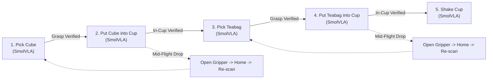

<div align="center">

# SO-101 Robot Arm Training & Deployment

**Dual-camera SO-101 policy training, multi-model sequencing, and closed-loop YOLOE + SmolVLA continuous task deployment built on `LeRobot 0.7.0`**

[](.python-version)
[](pyproject.toml)
[](https://docs.astral.sh/uv/)
[](local/)

[Usage Guide (`USAGE.md`)](USAGE.md) • [Architecture](#architecture--key-features) • [Quick Start](#quick-start) • [Project Structure](#project-structure)

</div>

---

## Overview

This repository is the final project implementation for NYCU's **ICT Micro-Credit Course — *Physical AI: Introduction to Robot Policy Training (MuJoCo × PyTorch on ROCm)***. It implements a closed-loop **YOLOE + SmolVLA** pipeline on a dual-camera (`wrist` + `side_45`) **SO-101** robot arm to autonomously perform a multi-stage beverage preparation task.

- **Core Architecture**: **SmolVLA** serves as the primary action-generation policy in the continuous pipeline, paired with **YOLOE** for high-level visual state monitoring.
- **Baseline Experiments Only**: **ACT**, **CNN**, and **FC (MLP)** scripts are included solely for simple standalone testing and comparison, and are not used in the final project architecture.

### Key Highlights
- **Closed-Loop Vision & Recovery**: In-process `YOLOE` visual-prompt monitoring verifies grasp lift, opaque-cup placement, and mid-flight drops, executing an automated recovery sequence (*open gripper to drop held object $\to$ return Home $\to$ re-scan baseline*) on timeout or failure.
- **SmolVLA Training via Imitation Learning (Teleoperation)**:
  - **Leader-Follower Setup**: Expert demonstrations are recorded via teleoperation, where a human operator manipulates the SO-101 **leader arm** and the **follower arm** mirrors its joint motions while capturing dual-camera observations and joint states.
  - **Dataset Scale**: **60 episodes** are collected by teleoperation for each sub-task; if model performance is not satisfactory, an additional **20 episodes** are collected for further fine-tuning.
  - **Camera-Aware 3D Trajectories**: Expert demonstrations must be clean and rational for a robot perceiving the 3D world through only two cameras (`wrist` and `side_45`). How the arm moves in 3D space directly affects the model's ability to perceive arm pose and depth.
  - **No Hesitation During Recording**: Avoid pausing or hesitating during teleoperation—practicing the task beforehand as a human operator is critical for collecting high-quality expert data.
  - **Multi-Object Distractor Scenes**: Make sure to collect demonstrations with multiple objects present on the table. If only a single target object is placed on the table during recording, the trained model can be easily interfered with or distracted by nearby non-target objects during deployment.

---

## Architecture & Key Features

### 5-Stage Closed-Loop Continuous Pipeline (YOLOE + SmolVLA)



---

## Quick Start

### 1. Environment Setup
This project uses [`uv`](https://docs.astral.sh/uv/) to manage Python 3.12 and all dependencies:

```bash
# Create .venv and install locked dependencies
uv sync

# (Optional) Install ultralytics for in-process YOLOE closed-loop monitoring
uv add ultralytics
```

### 2. Running Scripts (No Manual `.venv` Activation Needed)
```bash
# Inspect deployment CLI options
uv run python -u local/deploy_local.py --help

# Run offline 5-stage FSM simulation without hardware or checkpoints
uv run python -u local/deploy_continuous_task.py --dry-run --mock-models --simulate-failures
```

> [!NOTE]
> Do not edit `uv.lock` manually. Use `uv add <package>` / `uv remove <package>` to update dependencies, and keep `pyproject.toml`, `.python-version`, and `uv.lock` under version control.

---

## Script Reference (See [USAGE.md](USAGE.md))

All detailed CLI examples, training commands, and tuning flags are documented in **[USAGE.md](USAGE.md)**:

| Category | Description | Primary Script | Reference |
| :--- | :--- | :--- | :--- |
| **Camera Scan** | Scan available camera indices & live preview | `tools/camera_check.py` | [USAGE.md § 1](USAGE.md#1-相機編號掃描) |
| **Local Training** | Train SmolVLA / ACT / CNN / FC policies | `local/train_local.py` | [USAGE.md § 2](USAGE.md#2-本機訓練指令新資料集) |
| **Offline Dry-Run** | Validate inference without robot hardware | `local/deploy_local.py` | [USAGE.md § 3](USAGE.md#3-本機離線-dry-run-測試不需連接實體手臂) |
| **Single / Multi-Task** | Live deployment for SmolVLA / ACT / CNN / FC | `local/deploy_local.py` | [USAGE.md § 4](USAGE.md#4-so-101-單任務--多任務實機部署) |
| **Model Sequencing** | Fixed-step chaining across mixed checkpoints | `local/deploy_sequence.py` | [USAGE.md § 5](USAGE.md#5-多模型串接部署deploy_sequencepy) |
| **5-Stage Closed-Loop** | YOLOE calibration, validation & autonomous execution | `local/deploy_continuous_task.py` | [USAGE.md § 6](USAGE.md#6-閉迴路-5-階段連續任務部署yoloe--smolvla) |
| **Tuning & Homing** | Smooth homing and EMA / safety clamp options | `tools/go_home.py` | [USAGE.md § 7](USAGE.md#7-常用實機微調參數與輔助工具) |

---

## Project Structure

<details>
<summary>Click to expand directory tree</summary>

```text
SO101_Test/
├── .python-version                      # Pins Python 3.12 for uv
├── pyproject.toml                       # Project metadata & top-level dependencies
├── uv.lock                              # Locked dependency graph managed by uv
├── README.md                            # Repository overview (English)
├── USAGE.md                             # Complete script usage & deployment examples
├── colab/                               # Google Colab GPU training notebooks (lerobot==0.7.0)
│   ├── smolVLA_train.ipynb              # Baseline example (so101_pick_stylus)
│   ├── smolVLA_train_pick_cube.ipynb    # SmolVLA fine-tuning (so101_pick_cube)
│   ├── smolVLA_train_pick_teabag.ipynb  # SmolVLA fine-tuning (so101_pick_teabag)
│   ├── smolVLA_train_put_into_cup.ipynb # SmolVLA fine-tuning (so101_put_into_cup)
│   ├── smolVLA_train_shake_cup.ipynb    # SmolVLA fine-tuning (so101_shake_cup)
│   ├── smolVLA_train_multitask.ipynb    # SmolVLA multi-task fine-tuning
│   ├── act_train.ipynb
│   ├── cnn_train.ipynb
│   └── fc_train.ipynb
├── local/                               # Local training & SO-101 deployment scripts
│   ├── train_local.py
│   ├── deploy_local.py                  # Single / multi-stage deployment (SmolVLA / ACT / CNN / FC)
│   ├── deploy_sequence.py               # Sequential multi-checkpoint deployment
│   ├── deploy_continuous_task.py        # 5-stage closed-loop orchestrator (YOLOE + SmolVLA)
│   ├── smolvla_pool.py                  # SmolVLA preloading & hot-swap pool (gpu_full / gpu_experts / cpu_pinned)
│   ├── yolo_monitor.py                  # In-process YOLOE visual-prompt monitor & opaque-cup verification
│   ├── local_policies.py
│   └── local_utils.py
├── tools/                               # Hardware utilities & pre-flight checks
│   ├── camera_check.py                  # Scan camera indices and open live preview
│   ├── go_home.py                       # Smoothly return SO-101 arm to Home pose
│   └── verify_checkpoints.py            # Cross-PC SmolVLA checkpoint validator & switching benchmark
├── datasets/                            # LeRobot v3.0 datasets
│   ├── so101_pick_cube/                 # Cameras: wrist, side_45 | task: "Pick up the cube"
│   ├── so101_pick_teabag/               # Cameras: wrist, side_45 | task: "Pick up the teabag"
│   ├── so101_put_into_cup/              # Put object into cup dataset
│   └── so101_shake_cup/                 # Shake cup dataset
└── outputs/                             # Checkpoints (outputs/<arch>/<dataset_name>/checkpoints)
```

</details>
