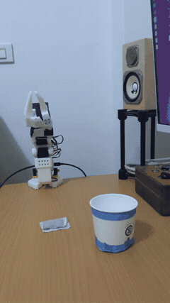
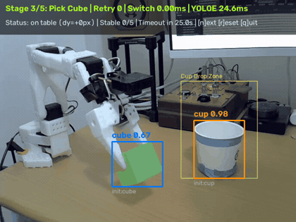
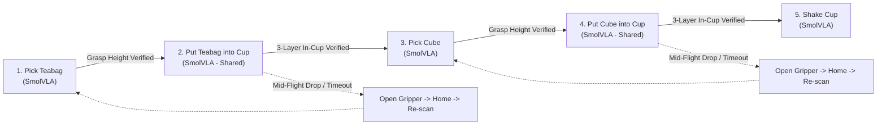
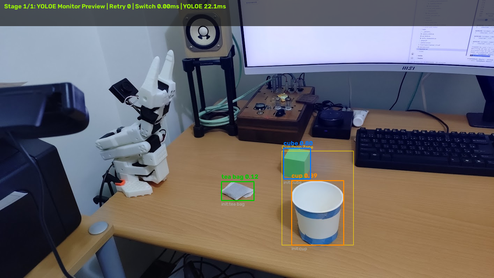
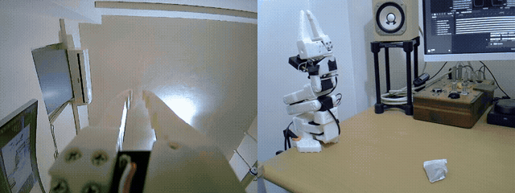
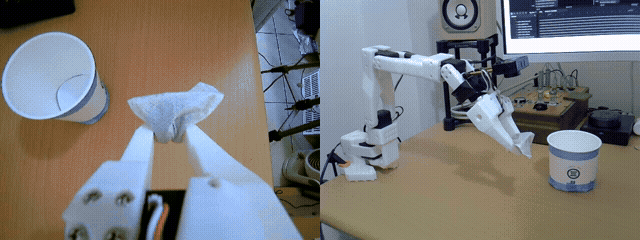
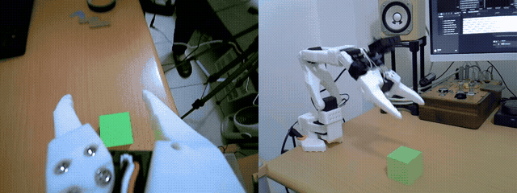
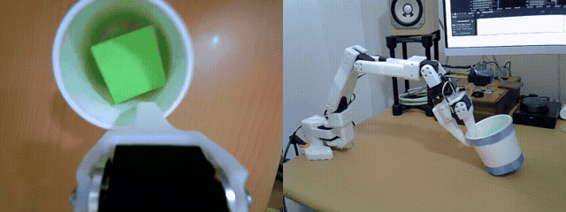
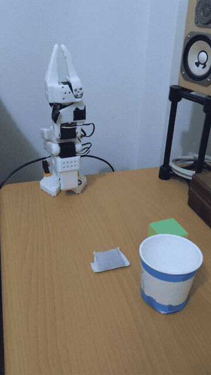

<div align="center">

# SO-101 Closed-Loop Autonomous Beverage Preparation

**Dual-camera SO-101 policy training, hot-swappable multi-model orchestration, and closed-loop YOLOE + SmolVLA continuous task deployment built on `LeRobot 0.7.0`**

[](.python-version)
[](pyproject.toml)
[](https://docs.astral.sh/uv/)
[](local/)

[Usage Guide (`USAGE.md`)](USAGE.md) • [Live Demos](#-live-demos) • [Architecture](#architecture--key-features) • [Dataset & Lessons Learned](#teleoperation-dataset--lessons-learned) • [Quick Start](#quick-start) • [Project Structure](#project-structure)

</div>

---

## Overview

This repository is the final project implementation for NYCU's **ICT Micro-Credit Course — *Physical AI: Introduction to Robot Policy Training*** (Group 123: 張韶華, 楊鈞喻, 黃南榮). It implements a **5-stage closed-loop YOLOE + SmolVLA** pipeline on a dual-camera (`wrist` + `side_45`) 6-DOF **SO-101** robot arm to autonomously perform a multi-stage beverage preparation task—picking a teabag into a cup, picking a cube (simulating an ice cube) into the cup, and shaking the cup to mix.

- **Core Architecture**: **4 specialized SmolVLA policies** execute **5 continuous stages** (reusing the `put_into_cup` policy for both teabag and cube placement), paired with **YOLOE** for dataset-free visual-prompt state monitoring and automated failure recovery.
- **Real-World Demo**: Completes the full 5-stage autonomous pick, place-into-opaque-cup, and shake sequence with zero human intervention, seamless GPU-pooled model switching, and manual-restart-free error recovery..
- **Baseline Experiments Only**: **ACT**, **CNN**, and **FC (MLP)** scripts are included solely for standalone baseline testing and comparison, and are not used in the final closed-loop architecture.

---

## 🎬 Live Demos

| Full 5-Stage Autonomous Task | Dynamic YOLOE + SmolVLA Hot-Swap Switching |
| :---: | :---: |
|  |  |
| *Autonomous teabag & cube pick-and-place into an opaque cup + shake* | *Real-time YOLOE state verification triggering GPU-pooled SmolVLA handoffs* |

---

## Core Challenges & Solutions

| Challenge | Solution Implemented |
| :--- | :--- |
| **Multi-Task Training Difficulty** | A single monolithic policy struggles across diverse manipulation primitives; **4 specialized single-task SmolVLA models** are orchestrated across the 5 stages (`put_into_cup` is shared by Stages 2 & 4). |
| **Opaque-Cup Occlusion** | Once an object is dropped into an opaque paper cup, it disappears from view; solved with **3-Layer Opaque-Cup Verification** (*cup mouth zone entry + gripper open + table object disappearance*). |
| **Multi-Model Switching Latency** | Reloading 4 policy checkpoints on the fly causes multi-second pauses; solved with **SmolVLA Preload & Hot-Swap Pool** (`gpu_full` / `gpu_experts` / `cpu_pinned` in [`local/smolvla_pool.py`](local/smolvla_pool.py)). |

---

## Architecture & Key Features

### 5-Stage Closed-Loop Continuous Pipeline (YOLOE + SmolVLA)



### Key System Capabilities
- **Dual-Camera Complementary Perception (`640×480 @ 30 FPS`)**:
  - **`wrist`**: Close-up alignment between gripper fingers and target objects, eliminating end-effector occlusion blind spots.
  - **`side_45`**: Global 3D workspace depth perception and real-time `YOLOE` state monitoring.
- **Dataset-Free YOLOE Visual Prompting & Recovery**:
  - Requires only **1 reference image** per object for real-time tracking (no extra YOLO dataset training).
  - Verifies **grasp lift stability** on `side_45`, **3-layer opaque-cup placement**, and **mid-flight drops**.
  - Executes automated recovery (*open gripper $\to$ return Home $\to$ re-scan baseline*) on drop or timeout, with safe shutdown and homing if max retries are exceeded.
- **Seamless Pose Handoff & Live HUD**:
  - Maintains a closed gripper while transitioning from grasp to the pre-placement pose before releasing.
  - Live HUD displays synchronized dual-camera bounding boxes, active stage, and retry status.

<div align="center">
  
  <br />
  <sub><em>YOLOE visual-prompt tracking and real-time bounding-box HUD during closed-loop execution</em></sub>
</div>

---

## Teleoperation Dataset & Lessons Learned

All expert demonstrations were collected via **6-DOF Leader-Follower teleoperation** at `640×480 @ 30 FPS` and stored in LeRobot v3.0 format under [`datasets/`](datasets/):

| Sub-Task | Dataset | Episodes | Total Frames | Language Instruction |
| :--- | :--- | :---: | :---: | :--- |
| **1. Pick Teabag** | `so101_pick_teabag` | 80 (60 + 20 fine-tune) | 29,552 | `"Pick up the teabag"` |
| **2. Pick Cube** | `so101_pick_cube` | 62 | 27,076 | `"Pick up the cube"` |
| **3. Put into Cup** | `so101_put_into_cup` | 60 | 24,625 | `"Pick the object into the cup"` |
| **4. Shake Cup** | `so101_shake_cup` | 60 | 37,434 | `"shake the cup"` |

### Dual-Camera Synchronized Demonstrations (`wrist` + `side_45`)

| Stage 1: Pick Teabag (`80 episodes`) | Stage 2 & 4: Put into Cup (`60 episodes`) |
| :---: | :---: |
|  |  |
| **Stage 3: Pick Cube (`62 episodes`)** | **Stage 5: Shake Cup (`60 episodes`)** |
|  |  |

### Practical Data Collection Guidelines
- **60 + 20 Progressive Expansion**: Collect **60 baseline episodes** per sub-task first; if real-robot evaluation is unsatisfactory, collect an additional **20 episodes** for targeted fine-tuning.
- **Camera-Aware 3D Trajectories**: Plan clean, rational trajectories so the two cameras (`wrist` and `side_45`) can unambiguously perceive arm pose and 3D depth.
- **No Hesitation During Recording**: Practice the task beforehand as a human operator and record smoothly without pausing or hesitating.
- **Multi-Object Distractor Scenes (Key Lesson Learned)**: Training with only a single target object on the table causes the policy to overfit to *"move toward the sole object"*, leading to severe visual confusion and lower success rates when other objects are present during deployment. Always include **distractor objects on the table** during teleoperation recording.

<details>
<summary>Case Study: Visual confusion when a single-object policy is deployed in a multi-object scene</summary>

<div align="center">
  
  <br />
  <sub><em>A policy trained without table distractors gets confused when multiple objects are present during deployment.</em></sub>
</div>

</details>

---

## Quick Start

### 1. Environment Setup
This project uses [`uv`](https://docs.astral.sh/uv/) to manage Python 3.12 and all dependencies:

```bash
# Create .venv and install locked dependencies
uv sync
```

### 2. Running Scripts (No Manual `.venv` Activation Needed)
```bash
# Inspect deployment CLI options
uv run python -u local/deploy_local.py --help

# Run offline 5-stage FSM simulation without hardware or checkpoints
uv run python -u local/deploy_continuous_task.py --dry-run --mock-models --simulate-failures
```

---

## Script Reference (See [USAGE.md](USAGE.md))

All detailed CLI examples, training commands, and tuning flags are documented in **[USAGE.md](USAGE.md)**:

| Category | Description | Primary Script | Reference |
| :--- | :--- | :--- | :--- |
| **Camera Scan** | Scan available camera indices & live preview | `tools/camera_check.py` | [USAGE.md § 1](USAGE.md#1-相機編號掃描) |
| **Local Training** | Train SmolVLA / ACT / CNN / FC policies | `local/train_local.py` | [USAGE.md § 2](USAGE.md#2-本機訓練指令新資料集) |
| **Offline Dry-Run** | Validate inference without robot hardware | `local/deploy_local.py` | [USAGE.md § 3](USAGE.md#3-本機離線-dry-run-測試不需連接實體手臂) |
| **Single / Multi-Task** | Live deployment for SmolVLA / ACT / CNN / FC | `local/deploy_local.py` | [USAGE.md § 4](USAGE.md#4-so-101-單任務--多任務實機部署) |
| **Model Sequencing** | Fixed-step chaining across mixed checkpoints | `local/deploy_sequence.py` | [USAGE.md § 5](USAGE.md#5-多模型串接部署deploy_sequencepy) |
| **5-Stage Closed-Loop** | YOLOE calibration, validation & autonomous execution | `local/deploy_continuous_task.py` | [USAGE.md § 6](USAGE.md#6-閉迴路-5-階段連續任務部署yoloe--smolvla) |
| **Tuning & Homing** | Smooth homing and EMA / safety clamp options | `tools/go_home.py` | [USAGE.md § 7](USAGE.md#7-常用實機微調參數與輔助工具) |

---

## Project Structure

<details>
<summary>Click to expand directory tree</summary>

```text
SO101_Test/
├── .python-version                      # Pins Python 3.12 for uv
├── pyproject.toml                       # Project metadata & top-level dependencies
├── uv.lock                              # Locked dependency graph managed by uv
├── README.md                            # Repository overview (English)
├── USAGE.md                             # Complete script usage & deployment examples
├── SO101_Final_Presentation.pptx        # Course final presentation slides
├── assets/                              # Images & GIFs for GitHub README rendering
│   ├── full_task_demo.gif               # Full 5-stage autonomous demo (39s, 1x speed)
│   ├── yolo_model_switch.gif            # Dynamic YOLOE + SmolVLA switching demo
│   ├── yolo_detection_presentation.png  # YOLOE HUD detection visualization
│   ├── distractor_failure.gif           # Multi-object distractor interference demo
│   ├── dataset_pick_teabag.gif          # Dual-camera dataset preview (Pick Teabag)
│   ├── dataset_put_into_cup.gif         # Dual-camera dataset preview (Put into Cup)
│   ├── dataset_pick_cube.gif            # Dual-camera dataset preview (Pick Cube)
│   └── dataset_shake_cup.gif            # Dual-camera dataset preview (Shake Cup)
├── colab/                               # Google Colab GPU training notebooks (lerobot==0.7.0)
│   ├── smolVLA_train.ipynb              # Baseline example (so101_pick_stylus)
│   ├── smolVLA_train_pick_cube.ipynb    # SmolVLA fine-tuning (so101_pick_cube)
│   ├── smolVLA_train_pick_teabag.ipynb  # SmolVLA fine-tuning (so101_pick_teabag)
│   ├── smolVLA_train_put_into_cup.ipynb # SmolVLA fine-tuning (so101_put_into_cup)
│   ├── smolVLA_train_shake_cup.ipynb    # SmolVLA fine-tuning (so101_shake_cup)
│   ├── smolVLA_train_multitask.ipynb    # SmolVLA multi-task fine-tuning
│   ├── act_train.ipynb
│   ├── cnn_train.ipynb
│   └── fc_train.ipynb
├── local/                               # Local training & SO-101 deployment scripts
│   ├── train_local.py
│   ├── deploy_local.py                  # Single / multi-stage deployment (SmolVLA / ACT / CNN / FC)
│   ├── deploy_sequence.py               # Sequential multi-checkpoint deployment
│   ├── deploy_continuous_task.py        # 5-stage closed-loop orchestrator (YOLOE + SmolVLA)
│   ├── smolvla_pool.py                  # SmolVLA preloading & hot-swap pool (gpu_full / gpu_experts / cpu_pinned)
│   ├── yolo_monitor.py                  # In-process YOLOE visual-prompt monitor & opaque-cup verification
│   ├── local_policies.py
│   └── local_utils.py
├── tools/                               # Hardware utilities & pre-flight checks
│   ├── camera_check.py                  # Scan camera indices and open live preview
│   ├── go_home.py                       # Smoothly return SO-101 arm to Home pose
│   └── verify_checkpoints.py            # Cross-PC SmolVLA checkpoint validator & switching benchmark
├── datasets/                            # LeRobot v3.0 datasets (640x480 @ 30 FPS)
│   ├── so101_pick_teabag/               # 80 episodes | "Pick up the teabag"
│   ├── so101_pick_cube/                 # 62 episodes | "Pick up the cube"
│   ├── so101_put_into_cup/              # 60 episodes | "Pick the object into the cup"
│   └── so101_shake_cup/                 # 60 episodes | "shake the cup"
└── outputs/                             # Checkpoints (outputs/<arch>/<dataset_name>/checkpoints)
```

</details>
